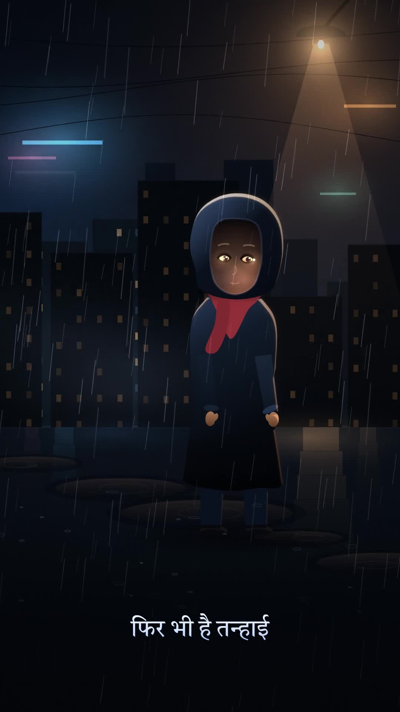

# गुमराहों का रास्ता — noir character lyric film

One character. One lamp. Forty-eight seconds of rain.

Built from the [`noir-character-lyric`](../../noir-character-lyric/SKILL.md) skill: a hand-rigged 2D walker acted against a rainy night, a warm rim on the silhouette, and the lyric sheet entering one couplet at a time in Tiro Devanagari Hindi.

| | |
|---|---|
|  | 1080×1920 · 48 s · 30 fps · H.264 + generated ambience<br>**[gumraahon-ka-raasta.mp4](../noir-character-lyric.mp4)** |

## How it is made

No browser, no GPU, no After Effects, no mesh library. `@napi-rs/canvas` draws each frame with the Canvas 2D API and the raw RGBA is piped straight into `ffmpeg`.

```
src/character.js   the rig: affine-matrix joints, coat, hood, face, rim-light pass, eyes
src/scene.js       night street: skyline, neon, sodium lamp, wet asphalt, puddles, 3-layer rain
src/type.js        Devanagari lyric cards (wrap, scrim, rise+blur entrance, matra-safe leading)
src/beats.js       every decision: 19 character poses, 19 camera keys, 15 lyric cards, 2 title cards
src/audio.js       the ambience bed: rain wash, D-minor drone, sparse plucks, thunder on the blackout
src/render.js      pose interpolation, automatic acting (breath/blink/weight), light events, grain
```

### The five ideas that make it work

1. **Backlit silhouette.** The figure is drawn three times per frame: ink, a white mask, and `mask − mask shifted away from the light`. That difference band is tinted warm and added with `lighter`, which gives a real rim on the nose, chin, shoulders and hem for free.
2. **The pose does the acting.** Every beat is legible as a black shape before the face is even visible: guarded → noticing → the mask → the mask drops → asking the night → hand to chest → offering → determined.
3. **Idle is acting.** Breathing on a 4.4 s cycle, irregular blinks, a 1–2° weight shift, the scarf and hem drifting. Nothing is ever frozen, and no part starts on the same frame as another.
4. **Devanagari rules.** Line height 1.46×, whole-block rise instead of type-on, a 0.10×size dark under-stroke, lyrics baseline at 1712 with the character grounded at ~1555.
5. **The light is a character.** The lamp flickers at 2.4 s, a cold shop sign stutters on at 20.4 s, a car's headlights rake the road at 30.9 s, and the lamp dies in two stutters at 43.6 s — leaving her silhouette and the rain for the last title.

## Render it yourself

```bash
npm i @napi-rs/canvas @ffmpeg-installer/ffmpeg
node src/audio.js --out assets/ambience.wav --dur 48
node src/render.js --still 8,16.8,27.6,36.2 --out stills   # look before you commit
node src/render.js --video assets/gumraahon-ka-raasta.mp4 --crf 17
```

About 0.17 s/frame on a 2-core box: roughly 4 minutes for the full 1440 frames.

## Try these edits

- **Different song section** — `POSES`, `CAMERA` and `LYRICS` in `src/beats.js` are plain tables. Change the times, keep the poses.
- **No rain** — `drawBackdrop(..., { rain: 0 })`; the light events still carry the atmosphere.
- **Warmer or bluer** — the rim gradient lives in `drawCharacter` (`rimTop`/`rimMid`/`rimBot`).
- **Landscape** — the rig is resolution-independent, but the camera keys and the lyric baseline (1712) are 9:16 numbers; remap them before switching.

Fonts: Tiro Devanagari Hindi and Mukta, both SIL Open Font License, committed under `assets/fonts/`.
